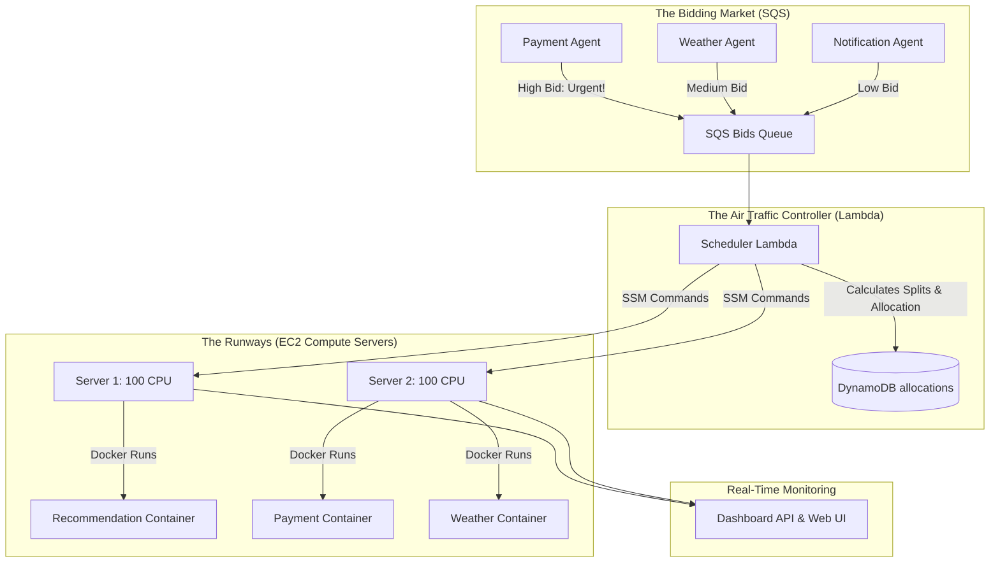

# CloudPulse: Dynamic Autonomous Resource Scheduler (Containerized Edition)
## End-to-End System Architecture, Engineering, and Operational Report

---

## 1. Executive Summary

**CloudPulse** is an autonomous, container-native cloud resource scheduling and orchestration system. In modern microservice architectures, applications experience varying load profiles. Traditionally, organizations handle this by over-provisioning resources (which is expensive) or using coarse-grained Auto Scaling Groups (which are slow to respond and scale entire VMs).

CloudPulse demonstrates a highly dynamic, micro-second responsive alternative: **micro-orchestration**. Four distinct Flask-based microservices (`payment-app`, `recommendation-app`, `weather-app`, and `notification-app`) compete for a limited pool of CPU resources across a cluster of two compute servers. Rather than running as bare operating system processes, these services are fully containerized using Docker. An intelligent control plane automatically scales, schedules, splits, or defers these containers in real-time based on live load metrics, priority urgency, and SQS-mediated market bidding, complete with LLM-generated operational reasoning.

---

## 2. Core Architectural Analogies

To understand the beauty of CloudPulse, we can use two powerful real-world analogies: **The Resource Auction Market** and **The Airport Air Traffic Controller**.



### Analogy A: The Resource Auction Market (Bidding)
* **The Microservices are Resource Buyers**: Each application has an autonomous **Agent** that acts as a financial bidder representing the service's interests.
* **CPU is the Finite Commodity**: The compute servers have a strict total limit of `100 CPU` capacity each.
* **SQS is the Bidding Queue**: When an app experiences a sudden spike in traffic, its agent writes a high-priority "Bid" (message) containing its requested CPU, wait time, and urgency baseline into an Amazon SQS queue.
* **The Lambda is the Auctioneer**: Every few seconds, the Lambda Scheduler runs. It drains the queue, scores all bids, and allocates the scarce CPU resources to the highest bidders first.

### Analogy B: The Airport Air Traffic Controller (Orchestration)
* **Compute Servers are Runways**: Server-1 and Server-2 are two flight runways, each capable of handling up to 100 units of weight (CPU).
* **Docker Containers are Airplanes**: Rather than letting cars drive aimlessly on the runways, each app is packaged as a **Docker Container** (a standardized airplane).
* **SSM Run Command is the Radio Tower**: The Lambda scheduler acts as the flight controller. It uses AWS Systems Manager (SSM) to radio the runways and issue exact commands: *"Airplane Payment, clear to land on Runway 2. Airplane Notification, taxi to hangar (deferred)."*
* **No `--rm` & Manual Control**: The airplanes do not automatically disintegrate when stopped. The radio tower explicitly issues `docker stop` and `docker rm` commands to safely guide them in and out of active status.

---

## 3. End-to-End Architectural Flow

The life cycle of a single resource allocation cycle operates in five sequential phases:

### Phase 1: Real-Time Monitoring & Bidding
Each Flask microservice runs a background polling daemon called the **Agent** (`agent.py`).
1. The agent polls its app's `/load` endpoint.
2. Inside the container, `psutil` reads `/proc/1/stat` to fetch the container-scoped CPU utilization.
3. If the load changes significantly, the agent triggers **Groq's Llama-3 model** to write a human-like operational justification (e.g., *"Payment processing is spiking due to a promotional event, requesting urgent allocation."*).
4. The agent compiles this into a JSON bid package and sends it to the SQS `bids-queue`.

### Phase 2: Scheduling & Scoring
The scheduler Lambda is triggered automatically by an Amazon EventBridge rule.
1. The Lambda drains all active bids from SQS.
2. It ranks each application using a multi-factor **Scoring Formula**:
   $$\text{Score} = (\text{Load} \times 0.4) + (\text{Urgency} \times 3.0) + \left(\frac{\text{WaitTime}}{3} \times 0.2\right) + (\text{DeferredTimes} \times 10.0)$$
3. This ensures that critical apps (like payments) rank higher, while starved apps (low-priority apps deferred repeatedly) receive a boost to prevent permanent resource starvation.

### Phase 3: Resource Allocation & Splitting
With sorted priorities, the scheduler allocates CPU capacity:
* **Preferred Server Allocation**: The system attempts to run apps on their preferred compute server (e.g. `recommendation-app` prefers Server-1).
* **Dynamic CPU Splitting (`BID_SPLIT`)**: If an app requests 80% CPU but the chosen server only has 60% left, the scheduler "squeezes" the application into the remaining space if the gap is within tolerance (`MAX_SPLIT_GAP_CPU = 30.0`).
* **Starvation Deferral**: If an application cannot fit anywhere, it is marked as `deferred`. Its containers are stopped, and its "deferred count" increases to boost its score in the next cycle.
* **Idle State**: Apps with near-zero activity are marked as `idle` and run on a single default instance with low priority so they remain reachable for future spikes.

### Phase 4: SSM-Docker Reconciliation
Once the allocation map is calculated, the Lambda uses AWS Systems Manager (SSM) to run Shell Scripts on the EC2 instances to sync the state:
* **Stopping Containers**: If an app was moved or deferred, SSM executes:
  ```bash
  docker stop <app_name> 2>/dev/null || true; docker rm <app_name> 2>/dev/null || true
  ```
* **Starting Containers**: To run an allocated service, SSM executes a robust check-and-run container block:
  ```bash
  if ! docker ps -q -f name=<app_name> -f status=running | grep -q .; then
      docker stop <app_name> 2>/dev/null || true
      docker rm <app_name> 2>/dev/null || true
      docker run -d --name <app_name> -p <port>:<port> cloudpulse/<app_name>:latest
  fi
  ```
  This is extremely safe because it gracefully cleans up any stopped or crashed containers of the same name before executing a new run command, entirely eliminating name conflicts.

### Phase 5: State Persistence & Visualization
1. The Lambda writes the cycle results (current server loads, active allocations, squeezed apps, and deferred lists) into a DynamoDB table.
2. The Dashboard API (`dashboard_api.py`) polls this DynamoDB state.
3. The Dashboard Web UI (`dashboard.html`) renders a stunning, premium dark-mode interface displaying live bar charts, CPU gauges, rebalancing indicators, and Groq-generated AI reasoning logs.

---

## 4. The Containerized Technology Stack

CloudPulse leverages a modern, robust technology stack:

### Core Frameworks & Python Libraries
* **Flask**: Lightweight web framework used to construct the microservices and the Dashboard API.
* **Gunicorn / Python HTTP**: Runs the high-performance application processes.
* **psutil (Process & System Utilities)**: Queries container-scoped CPU percentages. Inside Docker containers, this automatically scopes to the cgroup container limits instead of reading host-wide CPU metrics.
* **Boto3**: The AWS SDK for Python, facilitating communications with SQS, DynamoDB, Lambda, and SSM.

### Infrastructure & Containerization
* **Docker Engine**: Provides namespace isolation and resource constraints for the 4 microservices.
  * **Base Image**: `python:3.11-slim` ensures tiny image footprints (~120MB) and blazing-fast image builds.
  * **Multi-Stage Dependencies**: Pip requirements are cleanly layered. The `recommendation-app` contains heavy scientific processing (`numpy`), while others are kept minimal.
* **AWS EC2 (Amazon Elastic Compute Cloud)**:
  * Two compute EC2 instances run the active Docker engines.
  * One dedicated Agent/Dashboard instance hosts the polling daemons and dashboard server.
* **Amazon SQS (Simple Queue Service)**: Offers a fully decoupled, fault-tolerant message broker for bids.
* **AWS SSM (Systems Manager)**: Removes the need for open SSH ports (Port 22) in production, letting the control plane securely run Docker shell commands.
* **Amazon DynamoDB**: Key-value NoSQL database acting as a high-speed persistence layer for allocations.

### Artificial Intelligence & Interface
* **Groq SDK (Llama-3)**: Connects to ultra-low latency inference APIs to generate dynamic, human-like contextual reasoning summaries.
* **Vanilla HTML5/CSS3 & JavaScript**: Premium dark-mode UI with smooth CSS transitions, glassmorphic card grids, and micro-animations to present state metrics dynamically.

---

## 5. Operations and Commands Manual

Here is the operational checklist to manage, monitor, and run the CloudPulse cluster.

### A. Testing and Monitoring Containers
To check container runtimes and logs on the compute nodes from your local machine:

```bash
# SSH into Server-1 and list running containers
ssh -i "cloud-project-key.pem" ec2-user@44.219.23.100 "docker ps"

# SSH into Server-2 and list running containers
ssh -i "cloud-project-key.pem" ec2-user@54.209.233.61 "docker ps"

# Stream container resource stats in real-time
ssh -i "cloud-project-key.pem" ec2-user@44.219.23.100 "docker stats"

# Check standard output logs for weather-app
ssh -i "cloud-project-key.pem" ec2-user@54.209.233.61 "docker logs weather-app"
```

### B. Triggering CPU Load Spikes
You can trigger CPU load surges programmatically to watch the SQS bidding and SSM-Docker rebalancing take place:

```bash
# Trigger a 45-second CPU spike on payment-app (Server-2)
curl -X POST http://54.209.233.61:5000/work -H "Content-Type: application/json" -d "{}"

# Trigger a 45-second CPU spike on recommendation-app (Server-1)
curl -X POST http://44.219.23.100:5001/work -H "Content-Type: application/json" -d "{}"

# Trigger a 45-second CPU spike on weather-app (Server-2)
curl -X POST http://54.209.233.61:5003/work -H "Content-Type: application/json" -d "{}"

# Trigger a 45-second CPU spike on notification-app (Server-2)
curl -X POST http://54.209.233.61:5002/work -H "Content-Type: application/json" -d "{}"
```

### C. Rebuilding Microservice Containers
If you modify an app's code locally (e.g. `Weather.py`) and need to rebuild it:

1. **SCP the modified code to the compute nodes**:
   ```bash
   scp -i "cloud-project-key.pem" "Compute 2/Weather.py" ec2-user@44.219.23.100:~/apps/weather-app/app.py
   scp -i "cloud-project-key.pem" "Compute 2/Weather.py" ec2-user@54.209.233.61:~/apps/weather-app/app.py
   ```
2. **Trigger the Docker rebuild on the compute node**:
   ```bash
   ssh -i "cloud-project-key.pem" ec2-user@44.219.23.100 "cd ~/apps/weather-app && docker build -t cloudpulse/weather-app:latest ."
   ssh -i "cloud-project-key.pem" ec2-user@54.209.233.61 "cd ~/apps/weather-app && docker build -t cloudpulse/weather-app:latest ."
   ```

---

## 6. Conclusion

CloudPulse represents the future of autonomous, containerized resource scheduling. By combining decentralized **intelligent agents** that monitor localized container metrics, a centralized **Lambda decision plane**, and secure **SSM-Docker reconciliation**, the system dynamically handles capacity limits without any manual operations. It guarantees high availability for critical microservices, maximizes server utilization through dynamic splitting, and presents a beautiful glassmorphic monitoring console that makes complex resource rebalancing look effortless.
