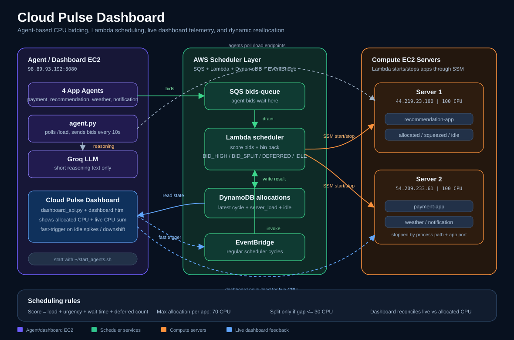

# CloudPulse: Dynamic Autonomous Resource Scheduler (Containerized Edition)

CloudPulse is an autonomous, container-native cloud resource scheduling and orchestration demo. Four Flask microservices compete for CPU across a cluster of two EC2 compute servers. Autonomous agents monitor container loads and submit bids through SQS. A Lambda-based control plane schedules capacity, persists state in DynamoDB, and dynamically reconciles resources on EC2 instances by stopping, removing, and starting Docker containers via AWS Systems Manager (SSM).

A real-time, glassmorphic dark-mode dashboard displays allocations, squeezed metrics, deferred queues, and LLM-generated reasoning logs for all operations.



---

## What It Demonstrates

- **Decentralized Bidding**: Each application is monitored by an autonomous agent daemon that bids for CPU via Amazon SQS based on load and priority.
- **Micro-Orchestration**: A centralized Lambda scheduler runs every few seconds to score bids, handle server allocations, split capacity, or defer starved services.
- **Docker Isolation**: Microservices run as isolated Docker containers rather than bare-metal operating system processes, mapping ports dynamically.
- **Cgroups CPU Tracking**: The services use `psutil.cpu_percent()`. Inside Docker namespaces, this automatically reads container-scoped CPU metrics (via cgroup `/proc/1/stat`) instead of host-wide metrics.
- **Secure Control Plane**: The control plane reconciles states via AWS Systems Manager (SSM) Shell Commands, executing container cleanup (`docker stop && docker rm`) and runner procedures without needing any open SSH inbound rules in production.
- **Generative AI Logs**: Groq APIs (Llama-3 model) generate human-like operational justifications for each application load shift on the live dashboard.

---

## Technology Stack

| Component | Technology / AWS Service | Purpose |
| --- | --- | --- |
| **Compute Nodes** | AWS EC2 Server-1 & Server-2 | Run containerized microservices under Docker |
| **Management Node** | AWS Agent/Dashboard EC2 | Hosts polling agent daemons and the dashboard server |
| **Microservices** | Python 3.11, Flask, Gunicorn | Port 5000 (Payment), 5001 (Recommendation), 5002 (Notification), 5003 (Weather) |
| **Container Engine** | Docker Engine (slim python base) | Isolates runtimes and resources for microservices |
| **Bidding Broker** | Amazon SQS `bids-queue` | Decoupled queue for storing SQS bid payloads |
| **Decision Engine** | AWS Lambda `scheduler` | Scores bids, splits capacity, and makes allocation choices |
| **Orchestration** | AWS SSM (Systems Manager) | Safely starts/stops Docker containers on compute nodes |
| **State Storage** | Amazon DynamoDB `allocations` | Stores latest allocation tables and load statistics |
| **Inference API** | Groq Llama-3 API | Dynamically writes operational reasoning logs |
| **Web Console** | HTML5, Vanilla CSS3, Javascript | Beautiful dark-mode dashboard showing dynamic updates |

---

## Repository Structure

* `docker/` — Docker configurations for the 4 microservices:
  * `payment-app/` — Dockerfile & minimal Flask dependencies
  * `recommendation-app/` — Dockerfile & Flask dependencies including `numpy`
  * `weather-app/` — Dockerfile & Weather metrics requirements
  * `notification-app/` — Dockerfile & Notification service requirements
* `Compute 2/` — Core Flask microservice application source codes
* `scheduler_lambda.py` — Updated Lambda scheduler that uses robust SSM-Docker reconciliation scripts
* `agent.py` — Polling agent daemon that monitors containers and publishes SQS bids
* `dashboard_api.py` — Reads DynamoDB allocation states and hosts the status API
* `dashboard.html` — Glassmorphic frontend web interface
* `commands.txt` — copy-paste operational cheat sheet
* `EndtoEndProjectReport.md` — Extended system architecture, analogies, and detailed operational breakdown

---

## Setup & Operational Guide

The complete build and run instructions are detailed in the **[Walkthrough Guide](walkthrough.md)**. A quick summary of steps:

### 1. Install Docker on Compute Nodes
SSH into both Server-1 and Server-2, and run the one-time Docker installation sequence:
```bash
sudo yum install docker -y
sudo service docker start
sudo usermod -aG docker ec2-user
exit
```
*Note: Re-SSH to apply user group configurations.*

### 2. SCP Files and Build Container Images
From your local workspace directory, upload all Dockerfiles, requirements, and source code files:
```bash
# Upload to Server-1 (Example for payment-app)
scp -i "cloud-project-key.pem" "docker/payment-app/Dockerfile" ec2-user@44.219.23.100:~/apps/payment-app/Dockerfile
scp -i "cloud-project-key.pem" "docker/payment-app/requirements.txt" ec2-user@44.219.23.100:~/apps/payment-app/requirements.txt
scp -i "cloud-project-key.pem" "Compute 2/cloud_proj/app.py" ec2-user@44.219.23.100:~/apps/payment-app/app.py
```
*(Repeat for all 4 apps to both Server-1 and Server-2).*

SSH into each server and trigger the Docker builds:
```bash
cd ~/apps/payment-app && docker build -t cloudpulse/payment-app:latest .
cd ~/apps/recommendation-app && docker build -t cloudpulse/recommendation-app:latest .
cd ~/apps/weather-app && docker build -t cloudpulse/weather-app:latest .
cd ~/apps/notification-app && docker build -t cloudpulse/notification-app:latest .
```

### 3. Deploy Lambda Scheduler
Copy the contents of **[scheduler_lambda.py](scheduler_lambda.py)** and paste them into your AWS Lambda code editor, then hit **Deploy**.

### 4. Run the Demo
SSH into the Agent/Dashboard EC2 instance (`98.89.93.192`) and run the daemon script to launch the dashboard and the 4 agents:
```bash
~/start_agents.sh
```

---

## Monitoring and Testing Spikes

Open the CloudPulse dashboard at `http://98.89.93.192:8080` in your web browser.

To simulate traffic spikes and trigger SQS bidding and dynamic container rescheduling, send POST requests to the `/work` endpoint of the active microservice:
```bash
# Spike the payment-app container (Server-2)
curl -X POST http://54.209.233.61:5000/work -H "Content-Type: application/json" -d "{}"

# Spike the recommendation-app container (Server-1)
curl -X POST http://44.219.23.100:5001/work -H "Content-Type: application/json" -d "{}"
```
Watch the dashboard rebalance dynamically! Squeezed apps will split resources, and lower-priority apps will automatically be stopped and deferred.